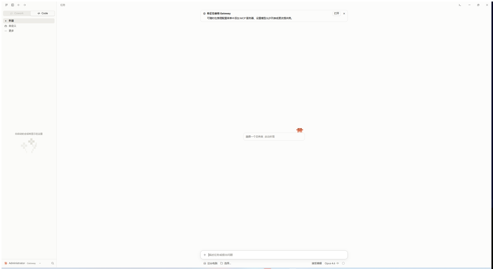

# claude-desktop-zh

> Claude Desktop 中文界面补丁：简体中文 / 繁體中文（台灣）/ 繁體中文（香港）
> 零依赖 · 自动备份 · 一键恢复 · 可重复运行



[](https://github.com/YOUR_GITHUB_NAME/claude-desktop-zh/actions/workflows/test.yml)


> [!IMPORTANT]
> 本项目是社区非官方项目，与 Anthropic 无关。它会修改本机 Claude Desktop 的程序文件，
> 请先阅读下方[注意事项](#注意事项与已知限制)。

## 特性

- **覆盖全面**：前端界面 40,000+ 词条（当前版本覆盖率 99.9%）、桌面壳层（菜单、托盘、系统对话框）99.7%。
- **安全可逆**：首次安装自动备份原版文件；任何时候都能一键恢复到与官方逐字节一致的状态。
- **可重复运行**：每次都基于原版备份重新生成补丁，切换语言、升级补丁都不会叠加修改。
- **先生成、再写入**：所有文件先在临时目录生成并校验，确认无误后才写入安装目录；写入失败自动回滚。
- **无损改写 asar**：自研流式 asar 读写，未改动的文件按字节原样拷贝，`unpacked` / 可执行元数据完整保留，
  并同步 Electron 的 ASAR 完整性哈希（Windows：`claude.exe`；macOS：`Info.plist` + Electron Framework）。
- **零依赖**：只需要 Node.js 18+，不需要 `npm install`。
- **新版本友好**：客户端新增但尚未翻译的词条自动保留英文，不会出现空白；附带覆盖率统计与未翻译条目导出工具。

## 支持情况

| 平台 | 安装方式 | 状态 |
| --- | --- | --- |
| Windows 10/11 | 官网 MSIX 安装包、Microsoft Store、旧版 Squirrel 安装包 | ✅ 补丁、启动、恢复已在 4.4212.0（安装目录副本）实测；直接写入 `WindowsApps` 的权限流程待更多反馈 |
| macOS | `/Applications/Claude.app` | ⚠️ 实验性（逻辑已实现，尚未在真机完整验证，欢迎反馈） |
| Linux | 社区打包版本 | 可用 `--app-dir` 手动指定，未测试 |

要求 Claude Desktop **4.29 及以上**（前端为 `resources/ion-dist.asar` 的版本）。

## 快速开始

1. 安装 [Node.js](https://nodejs.org) 18 或更高版本（Windows 也可以 `winget install OpenJS.NodeJS.LTS`）。
2. 下载本项目（`git clone` 或在 Releases 页面下载压缩包并解压）。
3. 退出 Claude Desktop（包括托盘图标）。

### Windows

双击 `install-windows.bat`，在 UAC 弹窗中允许管理员权限，然后按菜单选择语言即可。

### macOS

双击 `install-mac.command`（首次可能需要在“系统设置 → 隐私与安全性”中允许运行），按菜单操作。
需要时会提示输入登录密码。

### 命令行

```bash
# Windows 请在“以管理员身份运行”的终端中执行；macOS 需要时加 sudo
node bin/claude-zh.js install                 # 安装简体中文
node bin/claude-zh.js install --lang zh-TW    # 切换为繁體中文（台灣）
node bin/claude-zh.js status                  # 查看状态
node bin/claude-zh.js restore                 # 恢复官方原版
node bin/claude-zh.js coverage                # 统计当前客户端版本的翻译覆盖率
```

完整选项：

| 选项 | 说明 |
| --- | --- |
| `--lang <代码>` | `zh-CN`（默认）、`zh-TW`、`zh-HK` |
| `--app-dir <目录>` | 手动指定安装目录（Windows：包含 `claude.exe` 的 `app` 目录；macOS：`Claude.app`） |
| `--hardcoded` | 额外替换前端中未走 i18n 的硬编码文案，覆盖更全；替换带有比较/图标/对象键等多重安全保护，但客户端更新后风险略高 |
| `--no-override` | 不覆盖 `en-US` 词库，只注册独立的中文语言选项（见下方说明） |
| `--no-locale` | 不修改 Claude 配置中的 `locale` |
| `--kill` | Claude 正在运行时自动关闭 |
| `--force` | 检测到其他汉化补丁残留时仍继续 |
| `--dry-run` | 只生成补丁文件，不修改安装目录 |
| `--out <文件>` | 配合 `coverage`，导出未翻译条目 |

## Claude 更新之后

Claude Desktop 自动更新会用官方文件覆盖补丁，界面恢复英文。更新本项目后重新运行一次安装即可；
工具会识别到新版本并重新备份。旧版本的备份会在 `restore` 时清理。

## 工作原理

简述如下，详见 [docs/HOW-IT-WORKS.md](docs/HOW-IT-WORKS.md)。

1. **前端（`ion-dist.asar`）**：以当前版本的 `i18n/en-US.json` 为骨架合并中文译文，生成
   `i18n/zh-CN.json`；默认同时覆盖 `en-US.json`（Claude 4.29+ 在部分场景会把语言强制回 `en-US`，
   只注册新语言并不可靠）。在 JS bundle 的语言白名单中加入中文，并让 `Intl.DisplayNames` 显示中文名称。
2. **桌面壳层（`app.asar`）**：合并官方自带的 `zh-Hans`/`zh-Hant` 与本项目词库，生成主进程菜单、
   托盘、系统对话框使用的词库。
3. **完整性校验**：重新计算 asar header 的 SHA256，写回 `claude.exe`（Windows）或 `Info.plist`（macOS）。
4. **配置**：把 `config.json` 的 `locale` 设为所选语言（同时处理官方账号模式的 `Claude` 和第三方 API 模式的
   `Claude-3p` 数据目录）。

备份与状态保存在：

- Windows：`%LOCALAPPDATA%\claude-desktop-zh\`
- macOS：`~/Library/Application Support/claude-desktop-zh/`

## 注意事项与已知限制

- **数字签名失效**：Windows 上修改 `claude.exe` 会使其 Authenticode 签名失效；macOS 会改为本机 ad-hoc 签名。
  依赖签名校验的功能（例如 **Cowork 工作区沙盒**）可能无法使用。需要这些功能时请先 `restore`。
- **Windows 权限**：MSIX 版位于受保护的 `WindowsApps` 目录。工具**只**对需要改写的 3 个文件
  （`claude.exe`、`app.asar`、`ion-dist.asar`）接管所有权并授予管理员写权限，恢复时会把所有权交还给 TrustedInstaller。
- **English 也会显示中文**：默认模式覆盖了 `en-US` 词库，因此在 Claude 里切回 English 仍是中文。想要纯英文请 `restore`；
  或使用 `--no-override` 安装（仅新增独立语言，但在部分版本可能无法稳定生效）。
- **在线页面**：登录页等从 claude.ai 在线加载的页面不受本补丁影响。
- 修改客户端可能违反相关服务条款，请自行评估风险。

## 常见问题

**安装后仍是英文？** 完全退出 Claude（托盘图标也要退出）后重新打开；或在左下角账号菜单 → Language 中选择中文。
用 `node bin/claude-zh.js status` 检查状态。

**提示“Claude.exe 中找不到完整性标记”或“没有找到语言白名单”？** 说明客户端格式发生变化，
请附上 `status` 输出和 Claude 版本号到 Issues 反馈。此时安装目录不会被修改。

**提示“已经安装过其他汉化补丁”？** 请先用原补丁的恢复功能还原，或重新安装官方客户端。

**恢复失败怎么办？** 备份文件位于上面的数据目录中，可以手动复制回安装目录；重新安装官方客户端也可以彻底还原。

## 参与贡献

欢迎提交翻译修正与兼容性修复，见 [CONTRIBUTING.md](CONTRIBUTING.md)。

```bash
npm test                                 # 单元测试（只使用合成数据，不触碰已安装的客户端）
node tools/check-locales.js              # 对照本机客户端检查译文中的 ICU 占位符
node bin/claude-zh.js coverage --out missing.json   # 导出未翻译条目
```

## 致谢与许可

- 本项目以 [MIT License](LICENSE) 发布。
- 翻译词库源自 [javaht/claude-desktop-zh-cn](https://github.com/javaht/claude-desktop-zh-cn)（MIT），
  部分安全规则移植自该项目，详见 [NOTICE.md](NOTICE.md)。感谢原作者与所有翻译贡献者。
- “Claude” 是 Anthropic PBC 的商标；本项目不包含、不分发任何 Claude Desktop 程序文件。
